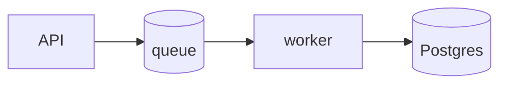

# README guide

A README answers, in order, the five questions every visitor has. If a
section doesn't serve one of them, cut it.

## The skeleton (annotated)

````markdown
# order-service
Processes orders and refunds for AcmeShop.        ← Q1: "is this for me?"
Status: production — on-call: #team-payments.       (status calibrates every promise)

## Quick start                                    ← Q2: "how do I try it?"
Requires Node 22+, Docker 27+.

```bash
git clone git@github.com:acme/order-service && cd order-service
cp .env.example .env          # defaults work for local dev
docker compose up -d db       # Postgres 16 on :5432
npm ci && npm run db:migrate
npm run dev                   # → http://localhost:3000/health
```

## Usage                                          ← Q3: "how do I do my task?"
Create an order:
```bash
curl -X POST localhost:3000/v1/orders \
  -H 'content-type: application/json' \
  -d '{"items":[{"sku":"tee-m","qty":2}]}'
# → {"id":"ord_9f2c","status":"pending","total_cents":4200}
```

## Configuration                                  ← Q4: "how do I adapt it?"
| Variable | Default | Purpose |
|---|---|---|
| `DATABASE_URL` | (none, required) | Postgres connection string |
| `PAYMENT_MODE` | `sandbox` | `sandbox` \| `live` |
See `.env.example` for the full list.

## Development                                    ← Q5: "how do I change it?"
```bash
npm test            # unit + integration (needs the docker db)
npm run lint
```
- `src/domain/` — business rules (start reading here)
- `src/http/`   — routes & DTOs
- `migrations/` — schema history
````

## Rules

- **Quick start is sacred**: works on a clean machine, exact versions,
  one screen. Test it in a fresh checkout — every extra step halves
  completion rate. Show **expected output** after key commands so readers
  know they're on track.
- State project status honestly (production / beta / weekend project).
- Screenshots/GIFs for anything visual; a diagram once there are 3+ moving
  parts:

````markdown

````

- Badges: only ones that inform (CI, version, license). Badge walls are
  noise.
- Keep it under ~300 lines; deeper material moves to `docs/` with links.
  The README is the map, not the territory.

## ADRs — record the *why* next to the code

```markdown
# docs/adr/0007-queue-over-cron.md
## Context
Refunds were processed by a 5-min cron; spikes caused 30-min delays.
## Decision
Move refund processing to a BullMQ queue with per-tenant concurrency 2.
## Consequences
+ p95 refund latency 30min → 40s;  − Redis becomes a hard dependency;
  cron kept as a dead-letter sweeper.
```

Half a page, immutable once accepted, numbered. When a decision is
revisited, write a new ADR that supersedes the old one — don't rewrite
history.
